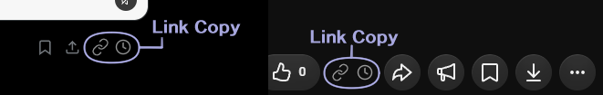

<div align="center">
  

  # LinkTrim

  URLの不要な追跡・共有パラメータを取り除いてコピーするブラウザ拡張機能です。
</div>

## ダウンロード・インストール

| ブラウザ | インストール |
| --- | --- |
| **Chrome / Edge / Vivaldi** | **[Chromeウェブストア](https://chromewebstore.google.com/detail/linktrim/mnfojcijmgbdhllgpieahejkhecblcnj)** |
| **Firefox** | **[Firefox Add-ons](https://addons.mozilla.org/ja/firefox/addon/linktrim/)** |

[最新リリース](https://github.com/mayomayowyi/LinkTrim/releases/latest)

[Chrome版 v0.0.1（ZIP・手動インストール）](https://github.com/mayomayowyi/LinkTrim/releases/download/v0.0.1/LinkTrim-chrome-v0.0.1.zip)も利用できますが、GitHubのZIPから手動インストールした版は自動更新されません。

## 主な機能

- URLの不要な追跡・共有パラメータを除去
- 右クリックメニューからリンク先のURLをコピー
- YouTubeの通常の再生リスト・ミックスリストなどからも、リスト情報を除いた動画単体URLをコピー
- X・YouTubeの動画の再生位置付きURLをコピー
- Xのタイムラインから投稿を開かずにコピー

### 対応サイト

- **v0.0.1：** YouTube、X（旧Twitter）
- **v0.0.2系（ストア更新版）：** YouTube、X（旧Twitter）、Amazon.co.jp、Wikipedia。YouTube Shorts・動画一覧・リストコピーや、Xの `t.co` リンクの元URLコピーにも対応します。

Chrome版は `0.0.2`、Firefox版は `0.0.2.1` です。各ストアへの反映状況は審査・公開状況によって異なります。

上記以外のサイトでも、ツールバーや右クリックメニューからURLをコピーできます。専用のコピーボタンやサイト固有のURL短縮には個別の対応が必要なため、**その他のサイトにも順次対応予定**です。

### URLの変換例

**赤い「−」が変換前、緑の「＋」がコピーされるURL**です。不要な部分だけを取り除きます。

#### YouTube

**① 通常の動画 — 共有パラメータを削除**

```diff
- https://youtu.be/ABCDEFG1234?si=ABCDefg12h34IjkL
+ https://youtu.be/ABCDEFG1234
```

**② 再生リスト内 — 動画だけのURLに変換**

```diff
- https://www.youtube.com/watch?v=ABCDEFG1234&list=PLexample123&index=3
+ https://www.youtube.com/watch?v=ABCDEFG1234
```

**③ ミックスリスト内 — 動画だけのURLに変換**

```diff
- https://www.youtube.com/watch?v=ABCDEFG1234&list=RDABCDEFG1234&start_radio=1
+ https://www.youtube.com/watch?v=ABCDEFG1234
```

#### X（旧Twitter）

**投稿URL — 共有パラメータを削除**

```diff
- https://x.com/abc_1/status/2115970570861031564?a=a1bCDefGHIJKLmNOPq2&s=20
+ https://x.com/abc_1/status/2115970570861031564
```

閲覧中のURLは変更しません。処理はブラウザ内で行い、広告・アクセス解析・外部へのデータ送信はありません。

## 使い方

### ツールバーからコピー

拡張機能のLinkTrimアイコンをクリックすると、開いているページのURLをコピーできます。

### 右クリックメニューからコピー

コピーしたいリンクを右クリックし、メニューの **「単体URLをコピー」** を選ぶと、リンク先のURLから不要なパラメータを取り除いてコピーできます。リンク先のページを開く必要はありません。

### X・YouTubeのページ内からコピー

XとYouTubeには、専用のコピーボタンが表示されます。

- **リンクアイコン**：投稿や動画の単体URLをコピー
- **時計アイコン**：動画の現在の再生位置付きURLをコピー

Xではタイムラインの投稿からも直接コピーできます。時計アイコンは動画付きの投稿に表示されます。

YouTubeでは、通常の再生リストやミックスリストから再生している動画も、リスト情報を取り除いて**動画単体のURL**としてコピーできます。



### YouTubeの一覧からコピー（v0.0.2系）

動画一覧のサムネイルにカーソルを合わせると、コピーボタンが表示されます。

- **リンクアイコン（鎖のマーク）**：動画単体のURLをコピー
- **リストアイコン（横線3本のマーク）**：再生リスト・ミックスリストのURLを、動画の指定なしでコピー

リストアイコンは、コピーできる再生リストがある場合に表示されます。

## Chrome / Edge / Vivaldiへの手動インストール（GitHub版）

1. [Chrome版ZIP](https://github.com/mayomayowyi/LinkTrim/releases/download/v0.0.1/LinkTrim-chrome-v0.0.1.zip)をダウンロードします。
2. ZIPを右クリックし、**「すべて展開」** を選びます。
3. アドレスバーに `chrome://extensions` と入力します。Vivaldiは `vivaldi://extensions` でも開けます。
4. 右上の **「デベロッパーモード」** をオンにします。
5. **「パッケージ化されていない拡張機能を読み込む」** を押し、展開したフォルダーを選びます。

フォルダーの直下に `manifest.json` があることを確認してください。ツールバーにアイコンを固定しておくと、すぐにコピーできます。

更新時は新しいZIPを展開して読み込み直してください。重複を避けるため、旧版は無効にします。

## Firefoxへのインストール

[Firefox Add-ons](https://addons.mozilla.org/ja/firefox/addon/linktrim/)で **「Firefoxへ追加」** を押してください。

## ライセンス

LinkTrimはMITライセンスで提供しています。最新バージョンのソースコード一式はGitHubへの反映準備中です。

[MIT License](LICENSE) — Copyright (c) 2026 MAYOI
