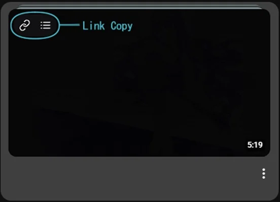

<div align="center">
  

  # LinkTrim

  URLの不要な追跡・共有パラメータを取り除いてコピーするブラウザ拡張機能です。
</div>

## ダウンロード・インストール

| ブラウザ | インストール |
| --- | --- |
| **Chrome / Edge / Vivaldi** | **[Chromeウェブストア](https://chromewebstore.google.com/detail/linktrim/mnfojcijmgbdhllgpieahejkhecblcnj)** |
| **Firefox** | **[Firefox Add-ons](https://addons.mozilla.org/ja/firefox/addon/linktrim/)** |

[最新リリース](https://github.com/mayomayowyi/LinkTrim/releases/latest)

## 主な機能

- URLの不要な追跡・共有パラメータを除去
- 右クリックメニューからリンク先のURLをコピー
- YouTubeの通常の再生リスト・ミックスリストなどからも、リスト情報を除いた動画単体URLをコピー
- X・YouTubeの動画の再生位置付きURLをコピー
- Xのタイムラインから投稿を開かずにコピー

### 対応サイト

- **v0.0.1：** YouTube、X（旧Twitter）
- **v0.0.2系（ストア更新版）：** YouTube、X（旧Twitter）、Amazon.co.jp。YouTube Shorts・動画一覧・リストコピーや、Xの `t.co` リンクの元URLコピーにも対応します。

Chrome版は `0.0.2`、Firefox版は `0.0.2.1` です。各ストアへの反映状況は審査・公開状況によって異なります。

上記以外のサイトでも、ツールバーや右クリックメニューからURLをコピーできます。専用のコピーボタンやサイト固有のURL短縮には個別の対応が必要なため、**その他のサイトにも順次対応予定**です。

### URLの変換例

**赤い「−」が変換前、緑の「＋」がコピーされるURL**です。以下は架空のID・ページ名を使った例です。

#### YouTube

**通常の動画 — 不要な共有パラメータを削除**

```diff
- https://youtu.be/abcd12ef34g?si=abcd12ef34gh5678
+ https://youtu.be/abcd12ef34g
```

#### X（旧Twitter）

**投稿URL — 共有パラメータを削除**

```diff
- https://x.com/example/status/1234567890123456789?a=abcd12ef34&s=20
+ https://x.com/example/status/1234567890123456789
```

#### Amazon.co.jp

**商品URL — 商品ID（ASIN）だけを残して短縮**

```diff
- https://www.amazon.co.jp/example-product/dp/B0AB12CD34/?_encoding=UTF8&pd_rd_w=abcd12ef34&ref_=sr_1_1
+ https://www.amazon.co.jp/dp/B0AB12CD34/
```

閲覧中のURLは変更しません。処理はブラウザ内で行い、広告・アクセス解析・外部へのデータ送信はありません。

## 使い方

### ツールバーからコピー

拡張機能のLinkTrimアイコンをクリックすると、開いているページのURLをコピーできます。

### 右クリックメニューからコピー

コピーしたいリンクを右クリックし、メニューの **「単体URLをコピー」** を選ぶと、リンク先のURLから不要なパラメータを取り除いてコピーできます。リンク先のページを開く必要はありません。

### X・YouTubeのページ内からコピー

XとYouTubeには、専用のコピーボタンが表示されます。

- **リンクアイコン**：投稿や動画の単体URLをコピー
- **時計アイコン**：動画の現在の再生位置付きURLをコピー

Xではタイムラインの投稿からも直接コピーできます。時計アイコンは動画付きの投稿に表示されます。

YouTubeでは、通常の再生リストやミックスリストから再生している動画も、リスト情報を取り除いて**動画単体のURL**としてコピーできます。

| X・YouTubeのリンク・再生位置コピー | YouTube一覧の単体リンク・リストコピー |
| :---: | :---: |
|  |  |

### YouTubeの一覧からコピー（v0.0.2系）

動画一覧のサムネイルにカーソルを合わせると、コピーボタンが表示されます。

- **リンクアイコン（鎖のマーク）**：動画単体のURLをコピー
- **リストアイコン（横線3本のマーク）**：再生リスト・ミックスリストのURLを、動画の指定なしでコピー

リストアイコンは、コピーできる再生リストがある場合に表示されます。

## Chrome / Edge / Vivaldiへの手動インストール（GitHub版）

1. [最新リリース](https://github.com/mayomayowyi/LinkTrim/releases/latest)を開き、**Assets** からChrome版のZIP（ファイル名に `chrome` を含むもの）をダウンロードします。
2. ZIPを右クリックし、**「すべて展開」** を選びます。
3. アドレスバーに `chrome://extensions` と入力します。Vivaldiは `vivaldi://extensions` でも開けます。
4. 右上の **「デベロッパーモード」** をオンにします。
5. **「パッケージ化されていない拡張機能を読み込む」** を押し、展開したフォルダーを選びます。

フォルダーの直下に `manifest.json` があることを確認してください。ツールバーにアイコンを固定しておくと、すぐにコピーできます。

更新時は新しいZIPを展開して読み込み直してください。重複を避けるため、旧版は無効にします。

## Firefoxへのインストール

[Firefox Add-ons](https://addons.mozilla.org/ja/firefox/addon/linktrim/)で **「Firefoxへ追加」** を押してください。

## ソースコード（OSS）

LinkTrimの実装、ブラウザ別Manifest、テストを公開しています。

- `src/`：拡張機能の実装
- `manifests/chrome.json`：Chrome版 v0.0.2
- `manifests/firefox.json`：Firefox版 v0.0.2.1
- `scripts/package.py`：配布用ZIP生成スクリプト
- `tests/`：自動テスト

```sh
npm test
python scripts/package.py
```

Python 3で追加依存なしにZIPを生成できます。テストにはNode.jsが必要です。出力先は`dist/`です。

## ライセンス

LinkTrimはMITライセンスで提供しています。ソースコード一式とビルド手順をこのリポジトリで公開しています。

[MIT License](LICENSE) — Copyright (c) 2026 MAYOI
